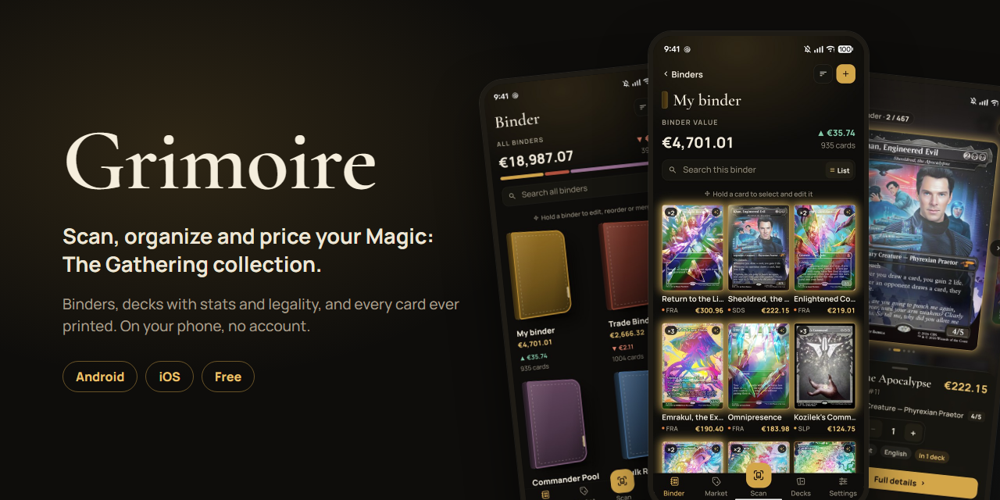
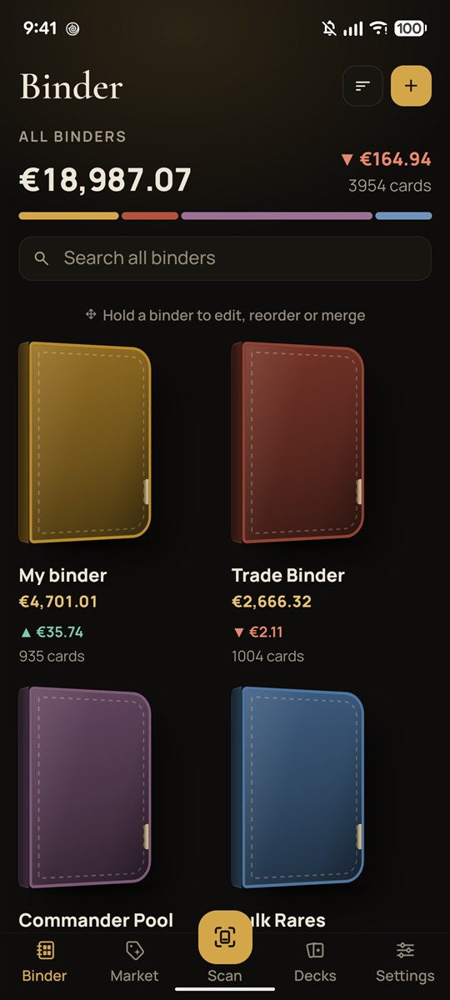
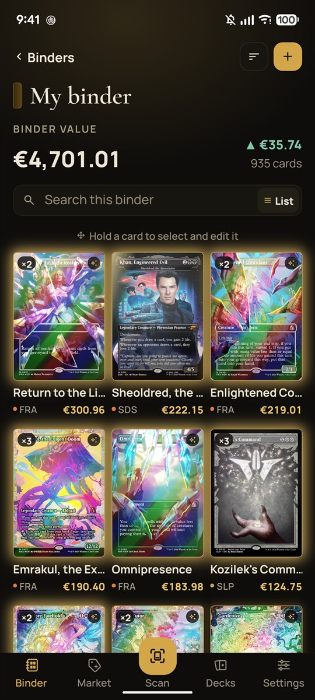
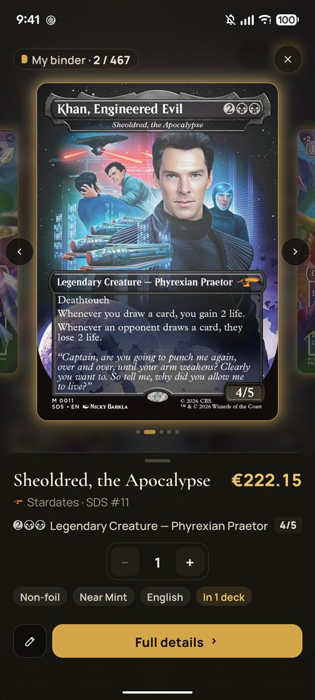
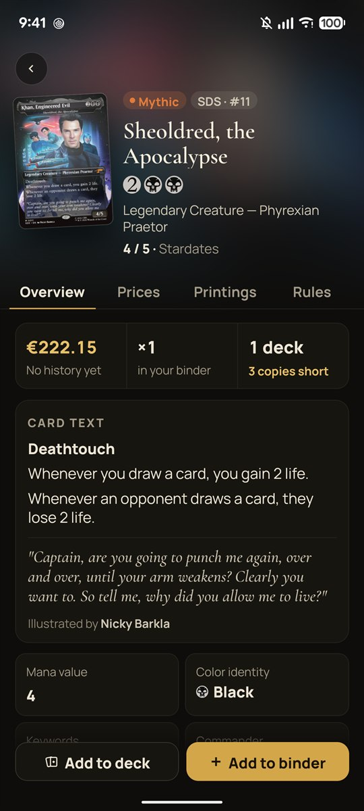
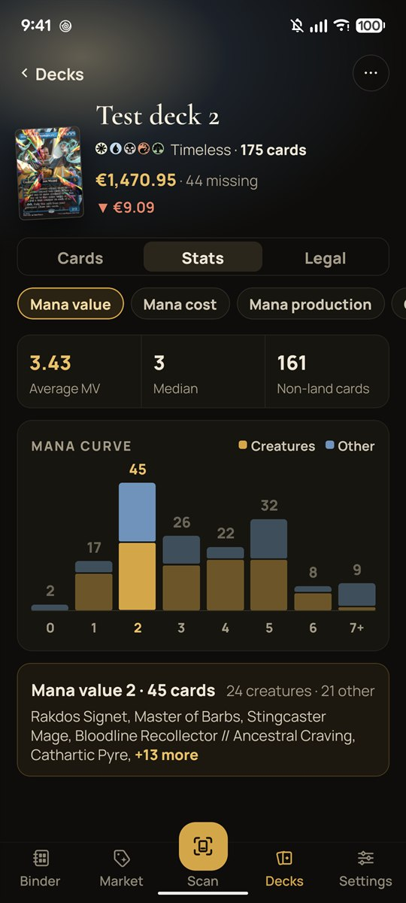
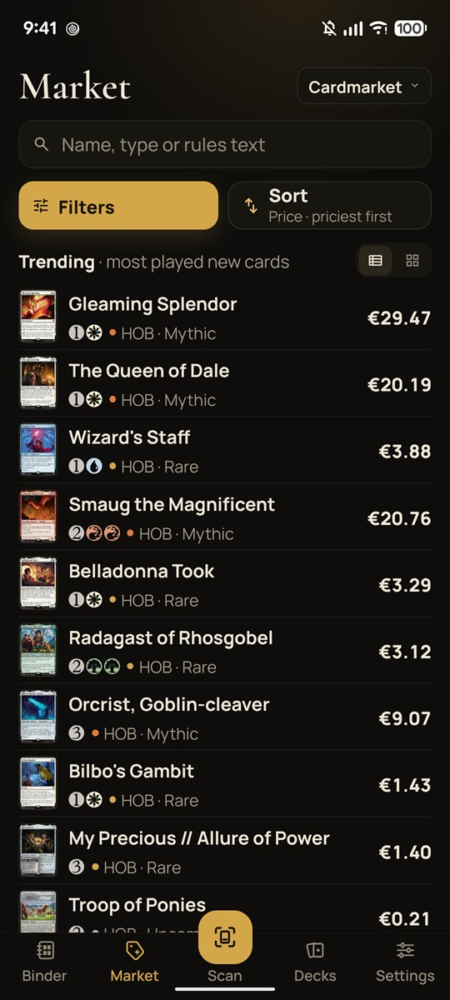

<p align="center">
  
</p>

<p align="center">
  <a href="https://github.com/SecreSwalowtail/Grimoire/releases/latest"></a>
</p>

<p align="center">
  <a href="LICENSE"></a>
  
  
  
</p>

**Grimoire is a free Magic: The Gathering collection app for Android and iOS.** Point your camera
at a card and it's in your binder. See what your collection is worth and how its value moves,
search every card ever printed, and build decks from what you own. No account, no ads: your
collection stays on your phone.

## Screenshots

<table>
  <tr>
    <td></td>
    <td></td>
    <td></td>
  </tr>
  <tr>
    <td></td>
    <td></td>
    <td></td>
  </tr>
</table>

## Features

- **Scan cards**: point the camera at a card and it's recognized from its set code and collector
  number, then added to your binder. Single mode, or Bulk mode for a whole stack.
- **Binders**: your collection as binder pages, with its value, how much it went up or down
  (over a week, a month or a year, you choose) and card count. Search, sort and group the cards,
  look at one up close (it tilts with your phone and foils shine), and hold cards to select and
  drag them: to another binder, into a deck, or into the trash.
- **Market**: search every Magic card through Scryfall by name, rules text or type, with filters
  for format legality, colors, mana cost, set, rarity and language.
- **Card detail**: the card, its prices (Cardmarket and TCGplayer) with price history, every
  printing and your copies of each, rules, rulings and format legality.
- **Decks**: decks and folders, a commander slot with partner rules, main deck, sideboard and
  maybe list, stats (curve, colors, types) and a legality check per format. Add cards straight
  from the deck's search, change copies with − / +, and drag cards between parts of the deck.
- **Your currency**: prices in euros, dollars or your own currency, converted with the European
  Central Bank's daily rates.
- **Bring your collection**: import a collection or a decklist exported from Manabox (text or
  CSV), and export your collection as a CSV that Moxfield and other apps read.

## Install

- **Android**: download the APK from the [latest release](https://github.com/SecreSwalowtail/Grimoire/releases/latest)
  and open it on your phone
- **iOS**: no App Store build yet. You can build it yourself from source on a Mac (see below).

## Run it from source

You need [Node.js](https://nodejs.org) (the current LTS version), and Android Studio (for Android) or Xcode on a
Mac (for iOS).

```bash
git clone https://github.com/SecreSwalowtail/Grimoire.git
cd Grimoire
npm install
npx expo run:android   # or: npx expo run:ios
```

The app uses native modules (camera, text recognition, Skia), so it doesn't run in Expo Go; the
commands above build a development version of the app on your phone or emulator.

## Built with

- [Expo](https://expo.dev) (SDK 57) and [React Native](https://reactnative.dev), in TypeScript
- [Expo Router](https://docs.expo.dev/router/introduction/) for navigation
- [Reanimated](https://docs.swmansion.com/react-native-reanimated/) and
  [Gesture Handler](https://docs.swmansion.com/react-native-gesture-handler/) for animation and
  drag and drop
- [Skia](https://shopify.github.io/react-native-skia/) for card effects
- [VisionCamera](https://react-native-vision-camera.com) and
  [ML Kit text recognition](https://developers.google.com/ml-kit/vision/text-recognition) for scanning
- [expo-sqlite](https://docs.expo.dev/versions/latest/sdk/sqlite/) for the collection, stored on the phone
- Card data and images from [Scryfall](https://scryfall.com)

## Contributing

Bug reports, ideas and pull requests are welcome. Read [CONTRIBUTING.md](CONTRIBUTING.md) to get
started, and look at the issues labelled
[good first issue](https://github.com/SecreSwalowtail/Grimoire/labels/good%20first%20issue) for a
place to begin.

If you like Grimoire, a ⭐ on GitHub helps other players find it.

## License

[PolyForm Noncommercial 1.0.0](LICENSE): you may read, learn from, copy and change this code for
any noncommercial purpose. Commercial use isn't allowed. This makes the project source-available
rather than open source.

## Legal

Grimoire is unofficial Fan Content permitted under the Fan Content Policy. Not approved/endorsed
by Wizards. Portions of the materials used are property of Wizards of the Coast.
©Wizards of the Coast LLC.

Card data and images: [Scryfall](https://scryfall.com). Prices: [MTGJSON](https://mtgjson.com),
from Cardmarket and TCGplayer. Grimoire is not affiliated with any of them.
